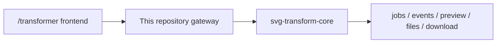

# SVG to HTML

[简体中文](README.md) | English

This repository is now the frontend and API gateway for `svg-transform-core`. It owns upload UI, job list UI, progress streaming, preview, download, and chat-repair UI. The actual SVG conversion, model calls, browser rendering, artifact storage, and Docker deployment belong to the standalone `svg-transform-core` service.

This repository no longer creates or reads local session artifacts, starts the local pipeline, or directly depends on models, browsers, or opencode for Web conversion. Old session data is not migrated, displayed, or kept compatible.

## Preview

Below is a visual comparison between the original design render and the generated page render. This run has a **4.33% visual difference**, or roughly **95.67% fidelity**.


| Original Design Render | Generated Page Render | Visual Difference |
| --- | --- | --- |
|  |  |  |

> Full interactive comparison page: [`example/comparison-4.33.html`](example/comparison-4.33.html)

## Architecture



The gateway exposes `/transformer/api/jobs/*` and forwards to the core service `/api/jobs/*`:

- `GET /transformer/api/jobs`
- `POST /transformer/api/jobs`
- `GET /transformer/api/jobs/:id`
- `POST /transformer/api/jobs/:id/start`
- `POST /transformer/api/jobs/:id/messages`
- `GET /transformer/api/jobs/:id/events`
- `GET /transformer/api/jobs/:id/preview`
- `GET /transformer/api/jobs/:id/files/*`
- `GET /transformer/api/jobs/:id/download`
- `DELETE /transformer/api/jobs/:id`

Preview, file, download, and SSE URLs are rewritten to `/transformer/api/jobs/...`, so the frontend never sees the core internal address or Docker-internal paths.

## Quick Start

### 1. Start core with Docker

Development and startup require `svg-transform-core` to run through Docker. Do not run the core service with local `apps/server dev`. By default, the `svg-transform-core` repository is expected next to this repository:

```bash
corepack pnpm install
corepack pnpm core:start
corepack pnpm core:health
```

`corepack pnpm core:start` calls `../svg-transform-core/scripts/docker-core.sh start` and reuses the existing container. If you changed core port, env, volume, image, or model config path, use:

```bash
corepack pnpm core:recreate
```

If the core repository is elsewhere, set:

```bash
SVG_TRANSFORM_CORE_REPO=/absolute/path/to/svg-transform-core corepack pnpm core:start
```

The core Docker service exposes `http://127.0.0.1:4310/health` by default.

### 2. Configure this gateway

```bash
cp .env.example .env
```

Make sure `.env` or the process environment contains:

```bash
PORT=81
SVG_TRANSFORM_CORE_URL=http://127.0.0.1:4310
```

`SVG_TRANSFORM_CORE_URL` is required. Startup checks `${SVG_TRANSFORM_CORE_URL}/health`; if it is missing or unreachable, the server exits.

### 3. Build and start this project

```bash
corepack pnpm install
corepack pnpm -C frontend build
corepack pnpm start
```

Open:

```text
http://localhost:81/transformer
```

## Service Management

```bash
corepack pnpm core:start                            # Start core Docker
corepack pnpm core:recreate                         # Recreate core Docker container
corepack pnpm core:status                           # Show core Docker status
corepack pnpm core:logs                             # Follow core Docker logs
corepack pnpm core:stop                             # Stop core Docker

bash backend/scripts/start-linux.sh start       # Start in background
bash backend/scripts/start-linux.sh stop        # Stop
bash backend/scripts/start-linux.sh restart     # Restart
bash backend/scripts/start-linux.sh status      # Show status
bash backend/scripts/start-linux.sh logs        # Follow logs
bash backend/scripts/start-linux.sh foreground  # Run in foreground
```

`corepack pnpm dev`, `corepack pnpm start`, and `backend/scripts/start-linux.sh start` all ensure core Docker is running before starting this gateway.

`backend/scripts/deploy.sh` remains a local script: copy the project to the target machine first, then run the script on that machine. It does not perform SSH/SCP orchestration; before starting this gateway, it starts core through local Docker.

## Requirements

| Dependency | Version | Notes |
| --- | --- | --- |
| Node.js | 20+ (recommended 22+) | Gateway runtime |
| pnpm via Corepack | 10.11+ | Specified in `packageManager` |
| Docker Desktop / Docker Engine | available | Core must run through Docker |
| svg-transform-core | sibling repo or `SVG_TRANSFORM_CORE_REPO` path | This project calls its Docker helper |

Browser, model provider, opencode, CDP, workspace, concurrency, and diff settings belong to `svg-transform-core`, not this gateway.

## Environment Variables

Key variables for the Web gateway:

| Variable | Default | Description |
| --- | --- | --- |
| `PORT` | `80` | Gateway HTTP listen port |
| `SVG_TRANSFORM_CORE_URL` | none | Required core service URL, for example `http://127.0.0.1:4310` |
| `SVG_TRANSFORM_CORE_REPO` | `../svg-transform-core` | Core repository path |
| `SVG_TRANSFORM_CORE_MODEL_CONFIG` | core repo `.runtime/model-provider.json` | Model config mounted into core Docker |

This gateway does not read browser, model provider, opencode, CDP, workspace, concurrency, or diff variables. Configure those in `svg-transform-core`.

## Verification

```bash
corepack pnpm -C backend run lint:types
corepack pnpm -C frontend build
corepack pnpm build
```

After core is running:

```bash
curl http://127.0.0.1:81/transformer/health
curl http://127.0.0.1:81/transformer/api/jobs
```

## Project Structure

```
backend/
  src/                    Express gateway source
  scripts/                 Local install, start, and deploy scripts
frontend/
  src/                    React 18 frontend source
  public/                 Built static assets served by the backend
example/                  Publishable fidelity comparison examples
```

## License

[MIT](LICENSE)
