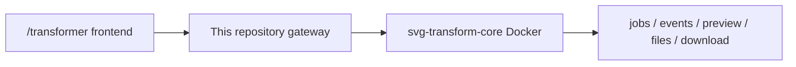

# SVG to HTML

[简体中文](README.md) | English

This is a feature-demo project built on top of `svg-transform-core`. This repository owns the Web UI and API gateway: SVG upload, job list, progress streaming, preview, download, and chat repair. The actual SVG conversion, model calls, browser rendering, and artifact writing are handled by the published `svg-transform-core` Docker image.

This repository is not a deployment system, does not include a local conversion pipeline, and does not require a local `svg-transform-core` checkout.

## Preview

Below is a visual comparison between the original design render and the generated page render. This run has a **4.33% visual difference**, or roughly **95.67% fidelity**.


| Original Design Render | Generated Page Render | Visual Difference |
| --- | --- | --- |
|  |  |  |

> Full interactive comparison page: [`example/comparison-4.33.html`](example/comparison-4.33.html)

## Architecture



The gateway exposes `/transformer/api/jobs/*` and forwards to the core service `/api/jobs/*`. Preview, file, download, and SSE URLs are rewritten to `/transformer/api/jobs/...`, so the frontend never sees the core internal address or Docker-internal paths.

## Quick Start

### 1. Install Dependencies

Install pnpm first, using whichever method fits your machine:

```bash
npm install -g pnpm@10.11.0
# or install pnpm with Homebrew / nvm / Volta / your preferred tool
```

Then install project dependencies:

```bash
pnpm install
```

### 2. Configure Models

```bash
cp .env.example .env
cp backend/config/model-provider.example.json backend/config/model-provider.json
```

Then edit `backend/config/model-provider.json` and fill in the real model provider, baseURL, provider model id, apiKey, or apiKeyEnv for each entry in `models`.

When uploading, you can select a model config ID that matches `models.<key>` in `backend/config/model-provider.json`. The first entry is used initially; later uploads keep the last selected model unless it no longer exists, in which case the first entry is used again.

`backend/config/model-provider.json` is ignored by Git and can contain local secrets. Only `backend/config/model-provider.example.json` is committed as the template.

### 3. Start the Demo

```bash
pnpm dev
```


The dev command will automatically:

- ensure `.env` and `backend/config/model-provider.json` exist, creating them from examples when missing
- start `ghcr.io/cnzhhx/svg-transform-core:latest`
- start the backend gateway
- start the Vite frontend dev server

Open:

```text
http://localhost:5173/transformer
```

The backend gateway defaults to:

```text
http://localhost:81/transformer
```

## Common Commands

```bash
pnpm dev                 # Start the demo
pnpm doctor              # Check Node, pnpm, Docker, core health, etc.
pnpm build               # Build frontend and type-check backend
pnpm core:status         # Show core Docker container status
pnpm core:logs           # Follow core Docker logs
pnpm core:recreate       # Recreate the core container with the local image
pnpm core:update         # Pull the latest image and recreate the core container
pnpm core:stop           # Stop the core Docker container
```

To pin the first published release, set this in `.env`:

```dotenv
SVG_TRANSFORM_CORE_IMAGE=ghcr.io/cnzhhx/svg-transform-core:0.1.0
```

To change core startup parameters, just edit `.env`. The next `pnpm core:start` (including `pnpm dev`) detects image, port, mount, and env changes and recreates the container automatically; use `pnpm core:recreate` when you want an immediate rebuild.

Changes that trigger automatic recreation include `SVG_TRANSFORM_CORE_IMAGE`, `SVG_TRANSFORM_CORE_URL` / `SVG_TRANSFORM_CORE_PORT`, `SVG_TRANSFORM_CORE_WORKSPACE`, `SVG_TRANSFORM_CORE_MODEL_CONFIG`, and `SVG_TRANSFORM_CORE_ENV_FILE`. If you only edit the contents of `backend/config/model-provider.json`, the mounted file path stays the same; if you are not sure whether core has reloaded it, `pnpm core:recreate` is the safest option.

The container runs with `--restart unless-stopped`, so it comes back after a Docker or machine restart.

`pnpm core:recreate` reuses the local `SVG_TRANSFORM_CORE_IMAGE` first and only downloads when that tag is missing locally. Use `pnpm core:update` when you want to pull the remote image again, especially for `latest`; after a pull, a plain `core:start` also notices the new image ID and recreates the container.

## Requirements

| Dependency | Version | Notes |
| --- | --- | --- |
| Node.js | 20+ (recommended 22+) | Gateway and frontend dev server runtime |
| pnpm | 10.11+ | Install with npm, Homebrew, nvm, Volta, or your preferred tool |
| Docker Desktop / Docker Engine | available | Core must run through Docker |
| svg-transform-core image | `ghcr.io/cnzhhx/svg-transform-core:latest` | This project pulls and runs the published image |
| @svg-transform/core-client | `0.2.0` | The gateway uses the published npm package, not a local core checkout |

Browser, model provider, opencode, CDP, workspace, concurrency, and diff settings belong to `svg-transform-core`, not this gateway code.

## Environment Variables

| Variable | Default | Description |
| --- | --- | --- |
| `PORT` | `81` | Gateway HTTP listen port |
| `SVG_TRANSFORM_CORE_URL` | `http://127.0.0.1:4310` | Core service URL |
| `SVG_TRANSFORM_CORE_IMAGE` | `ghcr.io/cnzhhx/svg-transform-core:latest` | Core Docker image |
| `SVG_TRANSFORM_CORE_MODEL_CONFIG` | `./backend/config/model-provider.json` | Model config mounted into core Docker |
| `SVG_TRANSFORM_CORE_WORKSPACE` | `./workspace/core` | Host task and artifact directory mounted into core Docker |
| `SVG_TRANSFORM_CORE_CONTAINER` | `svg-transform-core` | Core Docker container name |
| `SVG_TRANSFORM_CORE_PORT` | inferred from `SVG_TRANSFORM_CORE_URL` or `4310` | Core Docker host port |

## Project Structure

```
backend/
  src/                    Express gateway source
  scripts/                 doctor check script
frontend/
  src/                    React 18 frontend source
scripts/
  dev.sh                  pnpm dev entrypoint
  core-docker.sh          core Docker lifecycle helper
example/                  Publishable fidelity comparison examples
```

## License

[MIT](LICENSE)
