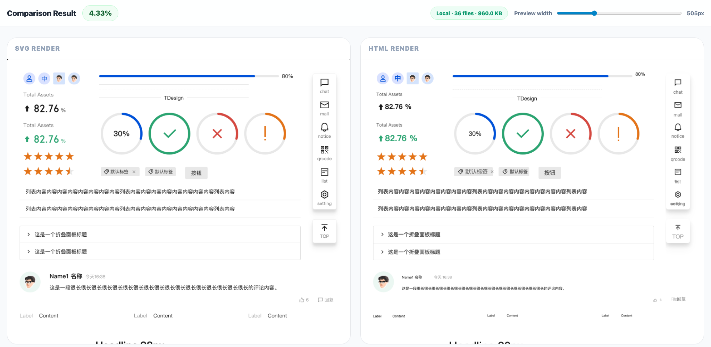

# SVG to HTML

[简体中文](README.md) | English

An SVG-to-web-page tool powered by `svg-transform-core`. This repository provides the Web UI and API gateway. Conversion runs in the published Core Docker image, so a Core source checkout is not required.

## Preview

This example has a **4.33% visual difference**, or roughly **95.67% fidelity**.



> [Open the interactive comparison](example/comparison-4.33.html)

## Local Development

Requires Node.js 20+, pnpm 10.11+, and Docker:

```bash
npm install -g pnpm@10.11.0
pnpm dev
```

The first start installs dependencies and creates `.env` and the model configuration automatically. Open `http://localhost:5173/transformer`.

## Model Configuration (Required)

Services can start with the placeholder configuration, but a real model is required before converting an SVG:

| Environment | Configuration file |
| --- | --- |
| Local development | `backend/config/model-provider.json` |
| Ubuntu deployment | `/etc/svg-to-html/model-provider.json` |

Minimal example:

```json
{
  "models": {
    "my-model": {
      "runtime": "opencode",
      "provider": "openai",
      "baseURL": "https://api.example.com/v1",
      "apiKey": "your-api-key",
      "model": "your-model-id",
      "modalities": {
        "input": ["text", "image"],
        "output": ["text"]
      }
    }
  }
}
```

- `my-model`: model configuration ID shown and submitted by the UI; choose any unique name.
- `provider`: API protocol provider. Use `openai` for an OpenAI-compatible endpoint.
- `baseURL`: model API base URL.
- `apiKey`: model credential.
- `model`: model ID expected by the provider.

Reload Core after editing the file:

```bash
pnpm core:recreate                          # Local
sudo bash scripts/service-ubuntu.sh restart # Ubuntu
```

The local model configuration is ignored by Git. The Ubuntu configuration lives outside the repository and is preserved during updates.

## Ubuntu Deployment

```bash
sudo bash scripts/deploy-ubuntu.sh
```

The script installs Node.js, pnpm, Docker, and Nginx, creates external configuration files, and starts the services. Fill in `/etc/svg-to-html/model-provider.json`, restart the service, then open `http://SERVER_IP/transformer/`.

After updating the source checkout, re-run the deployment command to redeploy without overwriting existing configuration. The installer exposes port 80 without built-in authentication; add TLS and access control in front of Nginx for public use.

## Common Commands

```bash
pnpm dev                 # Start locally
pnpm doctor              # Check the environment
pnpm core:logs           # Follow Core logs
pnpm core:recreate       # Recreate Core
pnpm core:update         # Update the Core image
pnpm core:stop           # Stop Core
```

The job APIs do not include authentication. Do not expose local development ports directly.

## License

[MIT](LICENSE)
