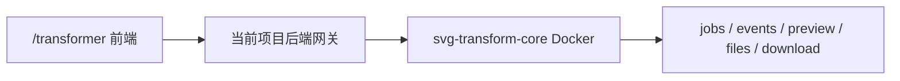

# SVG to HTML

简体中文 | [English](README.en.md)

这是一个基于 `svg-transform-core` 的功能展示项目。当前仓库负责 Web UI 和 API 网关：上传 SVG、查看任务、进度流、预览、下载和聊天修复；真正的 SVG 转换、模型调用、浏览器渲染和产物写入由已发布的 `svg-transform-core` Docker 镜像负责。

当前仓库不做部署系统，不内置本地转换 pipeline，也不要求本机存在 `svg-transform-core` 仓库。

## 效果预览

以下示例展示了原始设计稿渲染与生成页面渲染的视觉对比。本次视觉差异为 **4.33%**，还原度约 **95.67%**。


| 原始设计稿渲染 | 生成页面渲染 | 视觉差异图 |
| --- | --- | --- |
|  |  |  |

> 完整交互对比页面：[`example/comparison-4.33.html`](example/comparison-4.33.html)

## 架构



后端对外提供 `/transformer/api/jobs/*`，并转发到 core 的 `/api/jobs/*`。预览、文件、下载和 SSE 中的 URL 会被重写为 `/transformer/api/jobs/...`，前端不会接触 core 内网地址或 Docker 内部路径。

## 快速开始

### 1. 安装依赖

先安装 pnpm（任选一种方式）：

```bash
npm install -g pnpm@10.11.0
# 或者使用 Homebrew / nvm / Volta 等你习惯的方式安装 pnpm
```

然后安装项目依赖：

```bash
pnpm install
```

### 2. 配置模型

```bash
cp .env.example .env
cp backend/config/model-provider.example.json backend/config/model-provider.json
```

然后编辑 `backend/config/model-provider.json`，为 `models` 中的每个条目填入真实模型 provider、baseURL、模型 id、apiKey 或 apiKeyEnv。

上传时可以选择模型配置 ID，对应 `backend/config/model-provider.json` 里的 `models.<key>`。首次默认使用第一项，之后会记住上次选择，若配置中找不到该项则回到第一项。

`backend/config/model-provider.json` 被 `.gitignore` 忽略，可以放本地密钥；提交到仓库的只有 `backend/config/model-provider.example.json` 模板。

### 3. 启动展示项目

```bash
pnpm dev
```


开发启动会自动：

- 确保 `.env` 和 `backend/config/model-provider.json` 存在，缺失时从模板创建
- 拉起 `ghcr.io/cnzhhx/svg-transform-core:latest`
- 启动后端网关
- 启动 Vite 前端开发服务

访问：

```text
http://localhost:5173/transformer
```

后端网关默认在：

```text
http://localhost:81/transformer
```

## 常用命令

```bash
pnpm dev                 # 启动展示项目
pnpm doctor              # 检查 Node、pnpm、Docker、core health 等
pnpm build               # 构建前端并检查后端类型
pnpm core:status         # 查看 core Docker 容器
pnpm core:logs           # 查看 core Docker 日志
pnpm core:recreate       # 使用本地镜像重建 core 容器
pnpm core:update         # 拉取最新镜像并重建 core 容器
pnpm core:stop           # 停止 core Docker 容器
```

如果要锁定首个发布版本，可以在 `.env` 中改为：

```dotenv
SVG_TRANSFORM_CORE_IMAGE=ghcr.io/cnzhhx/svg-transform-core:0.1.0
```

改 core 启动参数时只需修改 `.env`，下次 `pnpm core:start`（包括 `pnpm dev`）会检测镜像、端口、挂载目录等配置变化并自动重建容器；想立即重建时仍可用 `pnpm core:recreate`。

会触发自动重建的修改包括 `SVG_TRANSFORM_CORE_IMAGE`、`SVG_TRANSFORM_CORE_URL` / `SVG_TRANSFORM_CORE_PORT`、`SVG_TRANSFORM_CORE_WORKSPACE`、`SVG_TRANSFORM_CORE_MODEL_CONFIG`、`SVG_TRANSFORM_CORE_ENV_FILE` 和 `MAX_PARALLEL_MODULE_AGENTS`。只改 `backend/config/model-provider.json` 内容时，文件路径没变，Docker 挂载仍然有效；如果不确定 core 是否重新读取了配置，执行一次 `pnpm core:recreate` 最稳。

容器默认带 `--restart unless-stopped`，Docker 或机器重启后会自动恢复。

`pnpm core:recreate` 会优先复用本机已有的 `SVG_TRANSFORM_CORE_IMAGE`，只有本机没有这个 tag 时才会下载。想主动更新 `latest` 或重新拉取远端镜像时，再执行 `pnpm core:update`；拉取新镜像后直接 `core:start` 也会发现镜像 ID 变化并自动重建。

## 环境要求

| 依赖 | 版本 | 说明 |
| --- | --- | --- |
| Node.js | 20+（推荐 22+） | 当前网关和前端开发服务运行时 |
| pnpm | 10.11+ | 用 npm、Homebrew、nvm、Volta 等方式安装均可 |
| Docker Desktop / Docker Engine | 可用 | core 必须通过 Docker 启动 |
| svg-transform-core 镜像 | `ghcr.io/cnzhhx/svg-transform-core:latest` | 当前项目直接拉取并运行已发布镜像 |
| @svg-transform/core-client | `0.2.0` | 当前网关使用 npm 线上包，不依赖本地 core 仓库 |

浏览器、模型 provider、opencode、CDP、workspace、并发和 diff 阈值都属于 `svg-transform-core` 的运行配置，不属于当前网关代码。

## 环境变量

| 变量 | 默认值 | 说明 |
| --- | --- | --- |
| `PORT` | `81` | 当前网关 HTTP 监听端口 |
| `SVG_TRANSFORM_CORE_URL` | `http://127.0.0.1:4310` | core 服务地址 |
| `SVG_TRANSFORM_CORE_IMAGE` | `ghcr.io/cnzhhx/svg-transform-core:latest` | core Docker 镜像 |
| `SVG_TRANSFORM_CORE_MODEL_CONFIG` | `./backend/config/model-provider.json` | core Docker 挂载的模型配置 |
| `SVG_TRANSFORM_CORE_WORKSPACE` | `./workspace/core` | core Docker 挂载的任务和产物目录 |
| `SVG_TRANSFORM_CORE_CONTAINER` | `svg-transform-core` | core Docker 容器名 |
| `SVG_TRANSFORM_CORE_PORT` | 从 `SVG_TRANSFORM_CORE_URL` 推断或 `4310` | core Docker 映射到宿主机的端口 |
| `MAX_PARALLEL_MODULE_AGENTS` | core 默认 `5` | 单个任务同时运行的模块 Agent 数；当前示例配置为 `4` |

## 项目结构

```
backend/
  src/                    Express 网关源码
  scripts/                 doctor 检查脚本
frontend/
  src/                    React 18 前端源码
scripts/
  dev.sh                  pnpm dev 入口
  core-docker.sh          core Docker 生命周期管理
example/                  可发布的还原度对比示例
```

## License

[MIT](LICENSE)
